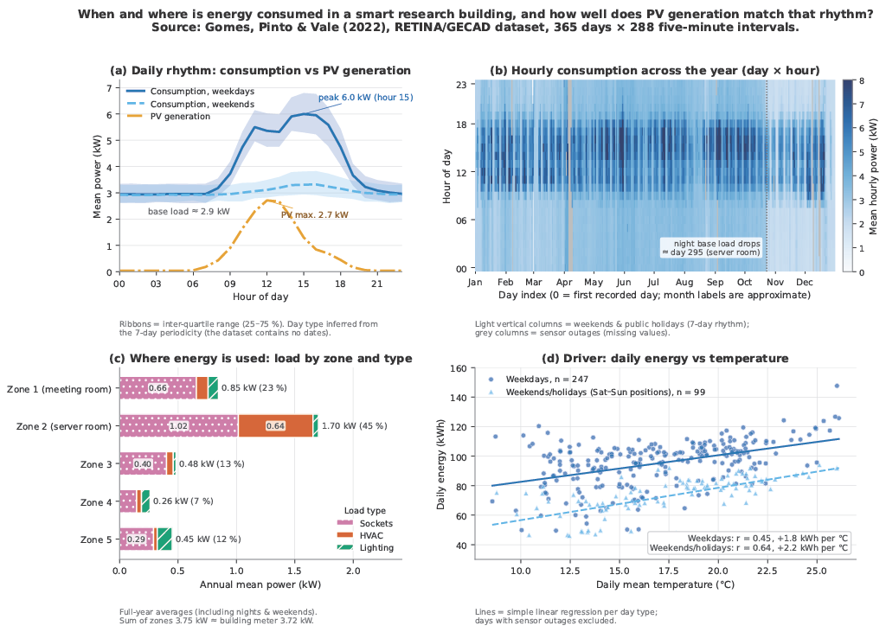

# When and Where Does a Smart Building Use Energy? — IJC445 Composite Visualisation

A composite of four Python charts built from one full year of 5-minute IoT data from the GECAD smart research
building in Porto (Gomes, Pinto & Vale, 2022; [Zenodo 6778782](https://doi.org/10.5281/zenodo.6778782), CC BY 4.0).
**Question:** *When and where is energy consumed in this building, and how well does on-site PV generation line up
with that rhythm of consumption?*



## Key messages

- **When (day):** weekday consumption peaks at ≈ 6.0 kW around 15:00; weekend peaks reach only ≈ 3.3 kW.
- **When (year):** a clear weekly occupancy rhythm, public holidays, sensor outages and a base-load change are all visible in the day × hour heatmap.
- **Where:** a base load of ≈ 2.9 kW never switches off. Sockets account for 67 % of the load, and Zone 2 (which includes the server room) accounts for 45 % of building power.
- **PV:** generation peaks at ≈ 2.7 kW at midday but never exceeds even the night-time base load, so it is almost entirely self-consumed.
- **Driver:** daily energy rises with outdoor temperature, more strongly at weekends (r = 0.64) than on weekdays (r = 0.45).

## Repository structure

```
code/
  module2_composite.py     # builds the 2 x 2 composite (Charts A–D) and saves facts.json
  smart_building_data.py   # data loading + cleaning (zeros/frozen readings -> NaN, PV failures, day types)
data/
  dataset.xlsx             # NOT included: download from Zenodo (see below)
figures/module2/           # composite.png, composite.pdf (output)
results/module2/           # facts.json: every number quoted in the report (output)
requirements.txt
```

## How to run

```bash
pip install -r requirements.txt
# 1. Download dataset.xlsx from https://doi.org/10.5281/zenodo.6778782
# 2. Put it in the data/ folder  ->  data/dataset.xlsx
python code/module2_composite.py
```

The first run reads the Excel file (≈ 40 s) and caches it in `code/cache/`; later runs take a few seconds.
The script writes `figures/module2/composite.png`, `figures/module2/composite.pdf` and `results/module2/facts.json`,
and it can be run from any working directory.

Tested with Python 3.13, pandas 2.3, NumPy, matplotlib 3.10 and openpyxl 3.1.
